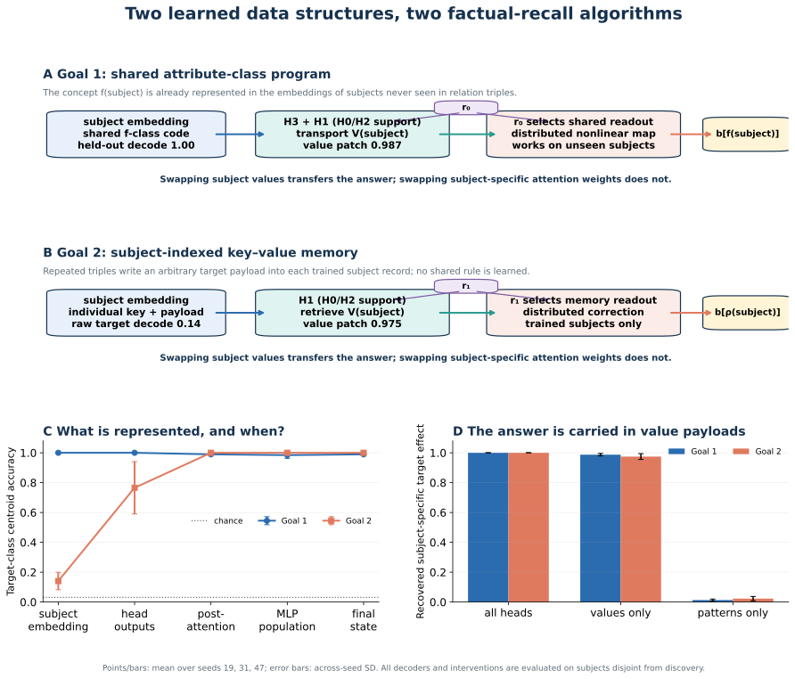

# Goal 1 and Goal 2: learned representations and algorithms



A representation is treated as mechanistically used only when swapping or ablating it changes the answer. All rankings are learned on one subject split and evaluated on a disjoint split.

## Goal 1 — shared attribute-class program

Attribute training organizes subject embeddings into 32 code families indexed by f(subject). A centroid learned on trained subjects decodes the target class of never-seen relation subjects with accuracy 1.000 ± 0.000. The code is distributed: subjects in a class share the task-relevant direction while retaining identity and g information.

```text
answer_semantic(subject):
    code = embedding[subject]                    # shared f-class code
    payload = H3.read_value(code, r0) + H1.read_value(code, r0)
              + smaller H0/H2 contributions
    state = relation_state[r0] + project(payload)
    state += distributed_class_readout(state)
    scores = dot(final_normalize(state), object_directions)
    return argmax(scores)                        # b[f(subject)]
```

Value-only subject swaps restore 0.987 ± 0.008 of the target-logit effect, while pattern-only swaps restore 0.013 ± 0.007. All-head mean ablation reduces object accuracy from 0.729 ± 0.094 to 0.031 ± 0.000. The relation selector acts mainly in the downstream readout: relation-conditioned head patches restore 0.070 ± 0.007, versus 0.850 ± 0.017 for the MLP population. An affine surrogate for all GELUs preserves the original held-out object accuracy, which establishes decision equivalence but not equality of transformations. Direct midpoint and exact-Jacobian tests of Goal 1 are reported in `results/final_linearity_goal1/goal1_linearity_analysis.md`.

## Goal 2 — subject-indexed key–value memory

Each trained subject embedding is an individual memory record containing a key and an idiosyncratic target payload. The same record also retains the semantic attribute code; r0 and r1 select different interpretations. Because subject values are formed before the following relation token is read, the payload is relation-independent and the relation acts as a memory-bank selector.

```text
answer_random(subject):
    record = embedding[subject]                  # key + rho(subject) payload
    retrieved = H1.read_value(record, r1)        # primary lookup
                + supporting H0/H2 reads         # H3 is negligible
    state = relation_state[r1] + project(retrieved)
    state += distributed_mlp_correction(state)
    scores = dot(final_normalize(state), object_directions)
    return argmax(scores)                        # b[rho(subject)]
```

The arbitrary target is weakly class-decodable in raw trained-subject embeddings (0.141 ± 0.058), becomes clearer in head outputs (0.766 ± 0.175), and is explicit after attention (1.000 ± 0.000). Value-only subject swaps restore 0.975 ± 0.020 of the target effect, versus 0.023 ± 0.014 for patterns. The post-attention state already answers 0.927 ± 0.052 of memorized facts, and the distributed MLP corrects the remainder to 1.000 ± 0.000.

The architecture-aware affine GELU surrogate still answers all disjoint memorized facts, which establishes decision equivalence but not equality of transformations. Direct midpoint and exact-Jacobian tests of attention, MLP, readout, and the full lookup are reported separately in `results/final_linearity_analysis/goal2_linearity_analysis.md`.

## Causal summary

| Intervention | Goal 1 | Goal 2 | Meaning |
|---|---:|---:|---|
| All-head subject swap | 1.000 ± 0.000 | 1.000 ± 0.000 | Subject record determines the answer |
| Value-only subject swap | 0.987 ± 0.008 | 0.975 ± 0.020 | Target content is carried in V payloads |
| Pattern-only subject swap | 0.013 ± 0.007 | 0.023 ± 0.014 | Subject-specific routing carries little target content |
| Accuracy without MLP | 0.552 ± 0.064 | 0.927 ± 0.052 | Attention performs retrieval; MLP reads/sharpens |
