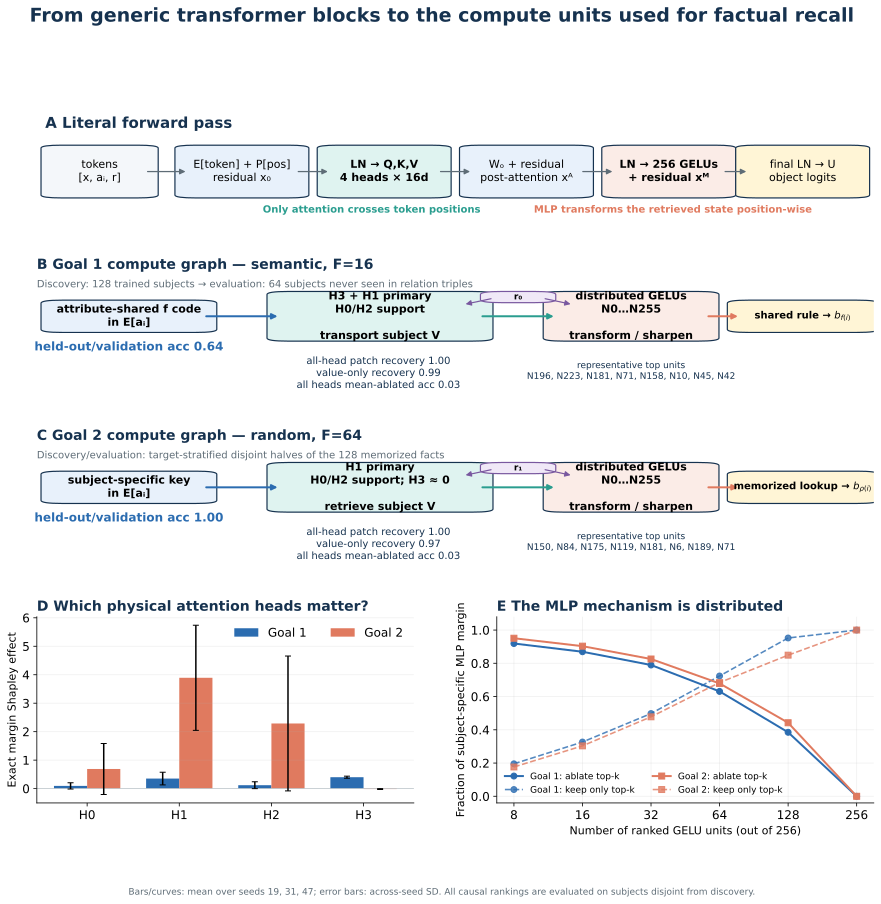

# Goal 1 and Goal 2: mechanistic forward-pass analysis



## Scope and evidential standard

This report analyzes the exact one-layer, four-head, 64-dimensional transformer used in the final Goal 1/2 runs. The archived runs stored metrics but not checkpoints, so every checkpoint was reconstructed by deterministic replay. For every seed and frequency, final loss, probe accuracy, trained recall, and held-out recall match the archived JSON to <1e-7. All component claims below therefore refer to the reported models, not a newly tuned surrogate.

A probe is treated only as evidence that information is available. A compute unit is called part of the mechanism only when an intervention changes the output. We use exact mean ablation, clean→corrupt activation patching, exhaustive head-subset tests, and neuron interventions ranked on one subject split and evaluated on a disjoint split. Attribution patching is used only after its approximation is checked against exact patching.

## The literal forward pass

For the final prompt position in `[x, a_i, r]`, the model computes

```text
x0 = E[r] + P[2]
h_h = Σ_t softmax(q_h(x0)·k_h(x_t)/√16)_t · v_h(x_t),   h = 0…3
xA = x0 + W_O concat(h_0,h_1,h_2,h_3)
m_n = GELU(w_in,n · LN(xA) + b_n),                       n = 0…255
xM = xA + Σ_n m_n w_out,n + b_out
logits = U · LN(xM)
```

Only the attention heads can move information from the subject at position 1 to the prediction position 2. The MLP is position-wise: it can transform or sharpen the retrieved state, but it cannot retrieve the subject on its own.

## Goal 1 — infrequent semantic relation (F=16)

On the never-seen relation subjects, the replayed models achieve full-vocabulary accuracy 0.635 ± 0.182. The logit lens changes object accuracy from 0.031 ± 0.000 at the bare relation residual, to 0.552 ± 0.064 after attention, and 0.729 ± 0.094 after the MLP.

The causal path is:

1. Attribute training organizes subject embeddings by the semantic target class. A target centroid learned only from trained subjects classifies held-out subject embeddings at 1.000 ± 0.000.
2. The semantic relation token supplies the final-position queries. Heads attend to the subject and transport its value vector to the final position. Replacing every head by its discovery-set mean changes object accuracy from 0.729 ± 0.094 to 0.031 ± 0.000.
3. In clean/corrupt subject swaps, patching all head outputs restores 1.000 ± 0.000 of the clean-target logit effect. Patching values while leaving corrupted attention patterns restores 0.987 ± 0.008; patching patterns while leaving corrupted values restores 0.013 ± 0.007. This separates transported content from routing.
4. The MLP is a distributed readout/sharpening stage. Its neuron rankings are learned on trained subjects and tested on held-out subjects. Mean-ablating the top 32 leaves 0.790 ± 0.032 of the subject-specific MLP margin; keeping only those 32 variable neurons recovers 0.498 ± 0.029. The full concentration curve, rather than a single cherry-picked unit, is stored in the JSON and plotted in the figure.
5. To isolate activation curvature from mere MLP involvement, each GELU is replaced by a per-neuron affine surrogate fit on trained subjects. On held-out subjects this fully affine MLP reaches 0.729 ± 0.092 object accuracy (activation R² 0.962 ± 0.001); deleting the MLP reaches 0.552 ± 0.064.

Thus Goal 1 is not merely ‘an affine probe works.’ The model uses the same attribute-organized subject code causally: relation-gated attention moves it to the prediction position, and a distributed MLP/readout converts it to the object logit. Because the code is shared by subjects with the same f-value, the circuit works on subjects whose relation triple never appeared.

Holding the subject fixed and swapping only r₀↔r₁ shows where relation selection occurs. For Goal 1, patching the four head outputs restores 0.070 ± 0.007 of the relation effect, whereas patching the MLP population restores 0.850 ± 0.017. The semantic selector therefore persists mainly through the relation residual into the MLP; the heads primarily transport subject content.

## Goal 2 — frequent random relation (F=64)

On a target-stratified, disjoint half of the trained facts, full-vocabulary accuracy is 1.000 ± 0.000. The same stage lens changes object accuracy from 0.031 ± 0.000, to 0.927 ± 0.052, to 1.000 ± 0.000.

The causal path is:

1. Repetition has trained a subject-specific code for the arbitrary target. Unlike Goal 1, it is not a rule that transfers to unseen subjects: archived held-out random recall is chance, while trained recall is 1.0 in every seed.
2. The random-relation token changes the queries/routing. The four head outputs jointly retrieve the memorized subject code. Mean-ablating all heads changes object accuracy from 1.000 ± 0.000 to 0.031 ± 0.000; the exhaustive 16-subset table and exact Shapley margin effects identify how the four physical heads share this work.
3. Clean/corrupt subject patching restores 1.000 ± 0.000 through all head outputs and 0.975 ± 0.020 through the value path alone. This is the causal signature of lookup: swapping the transported subject code moves the output toward that other subject's arbitrary target.
4. The post-attention code is transformed by a distributed population of literal GELU units. On disjoint trained facts, ablating the top 32 leaves 0.826 ± 0.014 of the subject-specific MLP margin, while retaining only those 32 variable units recovers 0.478 ± 0.022. Representative seed-specific IDs are shown in the figure; IDs are not expected to align across random initializations.
5. The nonlinear-representation claim must not be confused with a claim that GELU curvature alone performs the lookup. A per-neuron affine surrogate for every GELU reaches 1.000 ± 0.000 object accuracy on disjoint memorized facts (activation R² 0.924 ± 0.006); with the whole MLP deleted, attention alone reaches 0.927 ± 0.052. The experiment therefore localizes most arbitrary lookup to learned subject embeddings plus attention values, with the MLP providing margin and residual errors.

This is a non-generalizing memorization circuit: the model retrieves a learned subject key and transforms it through attention plus a distributed MLP into the memorized object direction. ‘Nonlinear’ in Goal 2 is the operational storage-format result—no affine map fitted on trained subjects predicts held-out random targets—not a stronger claim that every successful trained-subject forward pass requires GELU curvature. There is no class-shared rule for held-out subjects, which is why the same static affine probe and behavioral generalization both remain at chance.

With the subject held fixed, swapping r₁ for r₀ and patching the four random-relation head outputs restores 0.922 ± 0.024 of the relation effect; patching the MLP population restores 0.841 ± 0.032. At high frequency, relation selection is therefore strongly present in both the attention retrieval and its downstream transformation.

## Convergent causal evidence

| Test | Goal 1 | Goal 2 | Interpretation |
|---|---:|---:|---|
| All-head patch recovery | 1.000 ± 0.000 | 1.000 ± 0.000 | Subject information causally crosses attention |
| Value-only patch recovery | 0.987 ± 0.008 | 0.975 ± 0.020 | Content is in transported V vectors |
| Pattern-only patch recovery | 0.013 ± 0.007 | 0.023 ± 0.014 | Routing contribution separated from content |
| Attribution↔exact neuron patch Pearson r | 0.999 ± 0.000 | 0.993 ± 0.002 | Gradient screen checked against interventions |

## What the analysis does not claim

The neuron mechanism is distributed, so the report does not claim one universal ‘fact neuron.’ Unit numbers are local to a seed; the stable result is the computational role and causal concentration curve. Mean ablation is used instead of zeroing where possible to reduce out-of-distribution artifacts. The affine embedding geometry in Goal 1 is upstream structure; it becomes a mechanism claim only because subject-value and head patches show that the forward pass consumes it.

## Reproduction and artifacts

From `experiments/`:

```bash
uv run python -m factual_recall.linear_shift_mechanistic_analysis --device cuda
```

- `goal1_goal2_mechanistic_analysis.json`: every per-seed intervention and aggregate.
- `goal1_goal2_forward_pass.svg`: vector figure used above.
- `goal1_goal2_forward_pass.pdf`: publication-ready vector export.
- `goal1_goal2_forward_pass.png`: high-resolution raster preview.
